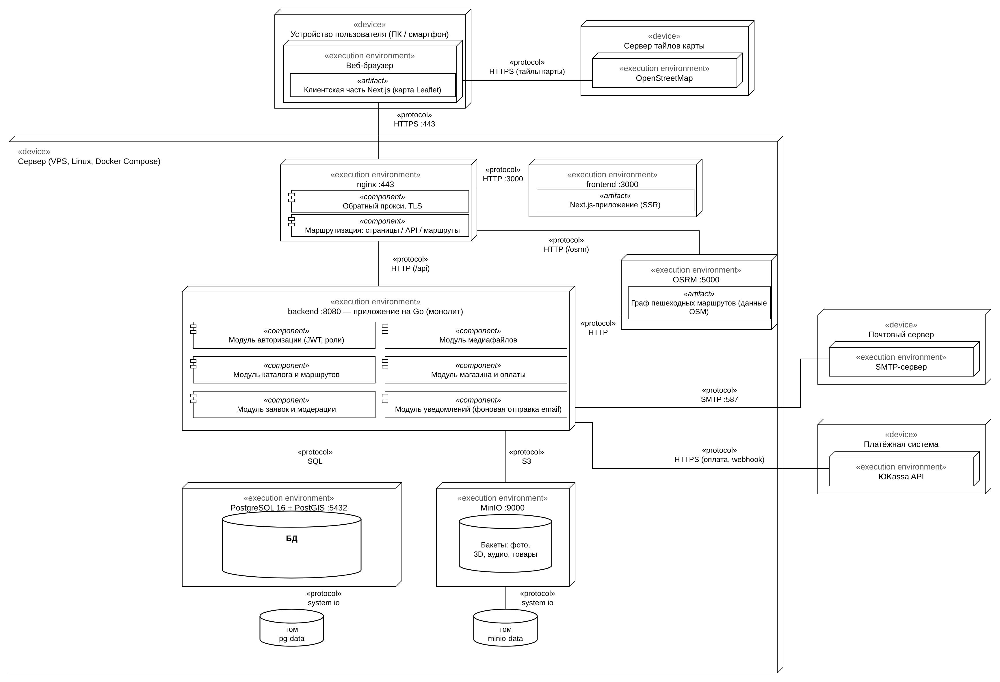

# Интерактивная веб-платформа историко-культурного наследия Астраханской области

Выпускная квалификационная работа. Платформа собирает в одном месте сведения о сохранившихся
и утраченных объектах наследия Астрахани: описание и историю, архивные фотографии, положение
на карте, пешеходные маршруты и панорамы 360°.

| | |
|---|---|
| **Автор** | Федосеев Александр Алексеевич, гр. ДИПРБ 41/2 |
| **Руководитель** | к.т.н., доцент Кузнецова В.Ю. |
| **Вуз** | ФГБОУ ВО «Астраханский государственный технический университет», кафедра «Автоматизированные системы обработки информации и управления» |
| **Заказчик** | АНО «Центр сохранения архитектуры» |

## Зачем

Сведения об одном объекте разбросаны по разным источникам: описание — в реестре, фотографии —
в архивах и соцсетях, местоположение — на картах. Утраченное здание вообще нельзя увидеть
иначе как на отдельных старых снимках. Платформа объединяет эти сведения, даёт пользователям
предлагать новые материалы через модерацию и показывает объекты в панорамном виде.

## Возможности

- **Интерактивная карта** объектов с поиском и фильтрами по категории и наличию панорамы.
- **Карточка объекта**: история, архитектор, стиль, «было — стало» по архивным фото, аудиогид.
- **Панорамы 360°**, в том числе созданные нейросетью по одной фотографии — с отметкой
  «Реконструкция ИИ» (подробнее — ниже).
- **Маршруты**: тематические и свои, линия по улицам строится через OSRM.
- **Заявки и модерация**: пользователь предлагает объект или дополнение, модератор одобряет
  или отклоняет с причиной; автору приходит письмо.
- **Магазин** сувениров с корзиной и оплатой через ЮKassa.
- Разделы «Истории», «Проекты», «Экскурсии», «Поддержать».

## Панорамы 360° по одной фотографии

Для объектов без панорамной съёмки панорама строится по обычной фотографии: фото проецируется
на сферу, нейросеть FLUX.2 [klein] с LoRA для достраивания панорам дорисовывает окружение, шов
на стыке краёв находится и исправляется автоматически. Здание остаётся подлинным снимком,
дорисованное окружение на сайте помечается. Генерация идёт на ПК модератора с видеокартой
от 8 ГБ, серверу платформы видеокарта не нужна.

```bash
tools/panorama/pano.sh фото.jpg kononov 95 6   # → ComfyUI/output/pano/kononov_360.jpg
```

Подробности, модели и сравнение с Stable Diffusion XL — [`tools/panorama/README.md`](tools/panorama/README.md)
и раздел 9 в [`Docs/README.md`](Docs/README.md).

## Технологии

| Часть | Стек |
|---|---|
| Клиент | Next.js 16, React 19, TypeScript, Tailwind CSS, Leaflet (OpenStreetMap), Pannellum |
| Сервер | Go 1.26, chi, pgx + sqlc, goose, JWT |
| Данные | PostgreSQL 16 + PostGIS; файлы — S3-совместимое хранилище (SeaweedFS) |
| Сервисы | OSRM (пешеходные маршруты), ЮKassa (оплата), SMTP (письма) |
| Развёртывание | Docker Compose |
| Панорамы | ComfyUI, FLUX.2 [klein] 4B + LoRA 360 ERP, Real-ESRGAN |

## Архитектура

Модульный монолит на Go: одно приложение и одна база данных, код разделён по слоям чистой
архитектуры (`domain → service → repository / transport`) и по модулям: авторизация, каталог,
медиафайлы, маршруты, заявки и модерация, магазин, уведомления. Модули не зависят друг от друга
напрямую, побочные эффекты передаются событиями через outbox в той же транзакции.



Подробно — [`backend/README.md`](backend/README.md) (модули, транзакции, список API).

## Запуск

**Сайт** (нужен Node.js 20+):

```bash
npm ci
npm run dev          # http://localhost:3000
```

**Сервер** (нужен Docker):

```bash
cd backend
cp .env.example .env              # задать пароли
docker compose up -d --build
curl http://localhost:8080/api/health
```

Сейчас сайт работает на статических данных из `src/data/`; подключение страниц к API сервера —
следующий этап.

## Структура репозитория

```
├── src/                 клиент Next.js: страницы (app/), компоненты, типы, данные
├── public/              изображения объектов, панорамы, Pannellum
├── backend/             сервер на Go, миграции БД, docker-compose.yml
├── tools/panorama/      создание панорамы 360° по фотографии (инструмент модератора)
├── Diagrams/            BPMN (AS-IS, TO-BE), Use Case, развёртывание, модели данных
└── Docs/                пояснения к ВКР, текст доклада, вопросы к защите, презентация
```

Диаграммы `.bpmn` открываются на [demo.bpmn.io](https://demo.bpmn.io), `.drawio` — на
[app.diagrams.net](https://app.diagrams.net).

## Права на материалы

Права на фотографии объектов принадлежат их авторам; для публикации нужно их разрешение. Панорамы с отметкой
«Реконструкция ИИ» созданы нейросетью: окружение здания дорисовано и может не совпадать
с действительностью.
